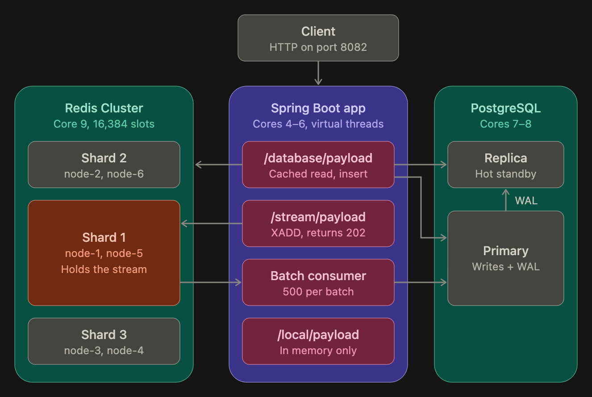

# High Throughput Server

Spring Boot service for load testing a PostgreSQL read path with a Redis cache in front. Spring Boot payload API with Redis caching, Redis Streams write-behind into PostgreSQL, and a wrk load test suite. Reaches ~33k cached reads/s and ~27k async writes/s on 3 cores, with no lost events.


## Architecture

## Running

### Everything in Docker

```bash
docker compose up -d --build
```

This starts a PostgreSQL primary and streaming replica, a six-node Redis Cluster and the app
(`load_test_app`) on `http://localhost:8082`. On first start, `redis-cluster-init` forms the cluster and exits.
After code changes, rebuild just the app with `docker compose up -d --build app`.
Follow its logs with `docker compose logs -f app`.

### App locally, dependencies in Docker

The cluster nodes are only reachable inside the compose network, so an app run outside
Docker uses a standalone Redis on `localhost:6379` instead:

```bash
docker compose up -d postgres postgres-replica
docker run -d --name redis-local -p 6379:6379 redis:7-alpine
./mvnw spring-boot:run
```

Requires Java 21 or later. Stop the container first (`docker compose stop app`),
since both use port 8082.

## Endpoints

| Method | Path                     | Description                                              |
|--------|--------------------------|----------------------------------------------------------|
| GET    | `/database/payload`      | Read a random seeded payload (id 1–100), from Redis if cached, else PostgreSQL; 404 if missing |
| POST   | `/database/payload`      | Create a payload synchronously: `{"hash": "..."}` (1–255 characters) → 201 |
| POST   | `/stream/payload`        | Queue a payload via Redis Streams: `{"hash": "..."}` → 202 with `eventId` |
| GET    | `/local/payload`         | Returns a fixed in-memory payload (no DB or cache)       |
| POST   | `/local/payload`         | Echoes an in-memory payload (no DB or cache)             |

Swagger UI is available at `/swagger-ui.html`.

On every startup the `payloads` table is recreated and seeded with 100 rows (ids 1–100).

## Caching

- `GET /database/payload` reads are cached in Redis under `payloads::{id}` for 10 minutes.
  Missing rows are not cached.
- A new row is cached on its first GET. Changes made directly in PostgreSQL can take
  up to 10 minutes to show for a cached row.
- **Redis is optional for reads.** If Redis is down or unreachable, cache errors are logged as
  warnings and reads fall through to PostgreSQL (see `config/CacheConfig.java`).
  Redis timeouts are 200 ms, so an outage adds at most that much per request.
  `POST /stream/payload` does need Redis and fails while it's down.

## PostgreSQL replication

`postgres` (container `fastapi_postgres`, port 5432) is the primary. `postgres-replica`
(container `postgres_replica`, port 5433) is a hot standby that streams the primary's WAL
and serves read-only queries.

### Read routing

Read-only transactions go to the replica; everything else goes to the primary
(`config/DataSourceConfig.java`). In practice that means cache misses in `GET /database/payload`:
Spring Data's `findById` runs in a read-only transaction. Writes, schema creation, seeding and
the stream consumer use the primary.

- A `LazyConnectionDataSourceProxy` picks the pool at the first SQL statement, after the
  transaction has marked the connection read-only.
- If the replica can't give a connection, `ReplicaFallbackDataSource` uses the primary and
  skips the replica for the next 5 s, logging one warning. The replica pool's 250 ms connection
  timeout and the driver's 1 s connect and 5 s socket timeouts bound how long a read waits.
- Reads can be stale by the replication lag (under 230 ms at full write load). A row read right
  after it was written may not be on the replica yet.
- Without `app.datasource.replica.jdbc-url`, all queries use the primary.

Tested on 2026-10-24:

- After clearing the cache, 300 reads ran 94 table scans on the replica and none on the primary.
  With a warm cache, only the remaining misses reached the replica.
- With the replica stopped while the app held 10 connections to it, 300 cold-cache reads all
  returned 200 (3.5 ms average). One request took 298 ms, waiting out the pool timeout before
  falling back; the primary served the reads. After the replica restarted, reads went back to it.
- Sync inserts measured 13.7k–15.4k req/s across three runs, about 19% below the 18.1k measured
  before routing. That is at the edge of run-to-run noise here and hasn't been isolated.

### Replication

- On first start the primary runs `postgres/primary-init.sh`, which creates the
  `replicator` role, a `pg_hba.conf` rule for replication connections and the physical
  replication slot `replica_1`.
- On first start the replica copies the primary with `pg_basebackup` and writes its standby
  settings (`postgres/replica-entrypoint.sh`). After that it starts as a standby straight away.
- The slot makes the primary keep WAL until the replica has received it, so a replica that
  falls behind or restarts catches up. `max_slot_wal_keep_size=1GB` caps that, so a dead
  replica can't fill the disk; past the cap the replica has to be rebuilt.
- Replication is asynchronous. With `synchronous_commit=off` as well, a primary crash can lose
  the last ~600 ms of acknowledged writes on both servers.
- Data now persists across container recreation. Earlier the primary's volume was mounted at
  `/var/lib/postgresql/data2` instead of the data directory, so nothing was kept.

Measured on 2026-10-24: writes reached the replica within 0.5 s. Under 20 s of full write load
it stayed at most 230 ms behind (about 70–85 ms on average, at most 0.9 MB of WAL), and it
ended with exactly the primary's 1,065,890 rows. Write throughput was unchanged (18,127 sync
inserts/s, 26,974 stream writes/s). After restarting the primary, replication resumed within
6 s. Failover isn't automatic; to promote the replica:

```bash
docker exec postgres_replica psql -U postgres -c "SELECT pg_promote()"
```

Then point `SPRING_DATASOURCE_URL` at `postgres-replica` and restart the app. The old primary
must be rebuilt as a replica before it rejoins. Check replication with:

```bash
docker exec fastapi_postgres psql -U postgres -c "SELECT client_addr, state, replay_lag FROM pg_stat_replication"
docker exec postgres_replica psql -U postgres -c "SELECT pg_is_in_recovery()"
```

## Redis Cluster

Under Docker Compose, Redis runs as a six-node cluster: `redis-node-1` to `redis-node-3`
start as primaries, each owning a third of the 16,384 hash slots, and `redis-node-4` to
`redis-node-6` are their replicas.

- Nodes have fixed IPs on the `backend` network (`172.30.0.11` to `.16`) because they find
  each other by IP from `nodes.conf`. They announce their hostnames to clients, so MOVED
  redirects name `redis-node-N`. Each node keeps its own append-only file and `nodes.conf`
  on its own volume.
- `redis-cluster-init` runs `redis-cli --cluster create` once, then exits. On later starts it
  sees `cluster_state:ok` and does nothing. The app starts only after it completes.
- The app gets the seed nodes from `SPRING_DATA_REDIS_CLUSTER_NODES` and discovers the rest.
  Lettuce re-reads the topology on redirects and reconnects, and every 10 s.
- Cache keys spread across the three primaries. The stream is a single key, so it lives on
  one primary and its write throughput is bounded by that node.

Check the cluster with:

```bash
docker exec redis-node-1 redis-cli cluster info
docker exec redis-node-1 redis-cli cluster shards
```

### Failover (tested 2026-10-24)

Killing `redis-node-1`, the primary holding the stream, under steady stream writes and
cached reads:

- Its replica `redis-node-5` became primary after about 7 s (5 s node timeout plus the
  election). The app picked up the new topology about 6 s later.
- Stream writes failed with 500 for about 13 s, then recovered on their own. Reads returned
  200 throughout; keys on the failed node's slots fell back to PostgreSQL.
- All 4,513 events that got a 202 reached PostgreSQL. Restarting `redis-node-1` made it
  rejoin as a replica of `redis-node-5`.
- 4 writes that returned 500 were still added to the stream later. Lettuce queues commands
  for a node while it is down and sends them, even after they timed out in the app, once it
  reconnects. A client that retries such a write creates a duplicate row. Queued reads also
  left those 4 entries pending on the consumer without it seeing them; the consumer now
  reclaims its own entries idle for over 30 s, so they were written about 40 s later.
- Replication is asynchronous, so a write acknowledged by a primary that dies before
  replicating it can be lost. None were lost in this test.

## Async writes (Redis Streams)

`POST /stream/payload` adds `{hash}` to the `payload:write-stream` stream and returns
`202 {"status":"QUEUED","eventId":"..."}` without touching PostgreSQL.
`PayloadBatchConsumer` drains the stream on its own thread (consumer group `payload-writers`):

- Reads up to 500 records at a time and inserts them into `payloads` in one transaction.
  Ids are generated by PostgreSQL; `created_at` is the publish time from the stream entry id.
- Each row stores its stream entry id in a unique `event_id` column, and inserts use
  `ON CONFLICT (event_id) DO NOTHING`, so replaying an event never creates a duplicate.
- Records are acknowledged (`XACK`) and deleted (`XDEL`) only after the DB commit, so the
  stream doesn't grow once events are written.
- If PostgreSQL or Redis is unavailable, records stay pending and are retried after 1 s.
- Records that can never be written (e.g. a missing or too-long hash) are moved to
  `payload:write-stream:dlq` with the error, and the rest of the batch still goes through.
- Each instance uses `HOSTNAME` as its consumer name (override with
  `payload.stream.consumer-name`). Every 30 s it claims records left pending for over 30 s,
  whether by another consumer (e.g. after a container is recreated) or by itself (a read
  whose reply never arrived).

The 202 response can't include the row id because the row doesn't exist yet. If the
consumer stops, the producer keeps accepting events and the stream grows without a limit.

Inspect the stream with:

```bash
docker exec redis-node-1 redis-cli -c XLEN payload:write-stream
docker exec redis-node-1 redis-cli -c XPENDING payload:write-stream payload-writers
docker exec redis-node-1 redis-cli -c XRANGE payload:write-stream:dlq - +
```

`-c` follows the redirect to whichever primary owns the key.

## CPU layout

Each container is pinned to its own cores in `docker-compose.yaml`:

| Cores | Used by                       |
|-------|-------------------------------|
| 0–3   | Free for the load generator   |
| 4–6   | App (`load_test_app`)         |
| 7–8   | PostgreSQL primary and replica |
| 9     | Redis Cluster (all six nodes) |

To see how throughput scales with the app's core count, override `APP_CPUSET` and
recreate only the app:

```bash
APP_CPUSET=4 docker compose up -d app      # 1 core
APP_CPUSET=4-5 docker compose up -d app    # 2 cores
APP_CPUSET=4-6 docker compose up -d app    # 3 cores (default)
```

If the load generator runs in Docker, keep it off these cores with `--cpuset-cpus=0-3`.

On Docker Desktop these are the Linux VM's virtual CPUs, not dedicated physical cores,
so use the results to compare runs rather than as absolute capacity numbers.

## Load testing

Start the stack and warm up the JVM for ~15 s before measuring; runs on a freshly
started app understate throughput.

### Full suite

`loadtest/run.sh` tests every endpoint with [wrk](https://github.com/wg/wrk) (4 threads,
50 connections): a 10 s warmup, then a 20 s measured run, while recording `docker stats`.
It needs `wrk` and `python3`, and the compose stack running.

```bash
./loadtest/run.sh
```

It prints a summary, then checks that every `POST /stream/payload` request became a row:

```text
test              req/s      p50      p90      p99    p99.9  errors
get_database     33,488    1.35ms   1.88ms   4.23ms   22.2ms       0
...
Stream: 828270 requests -> 828361 rows, backlog 0, pending 0, dead-lettered 2
```

Raw output goes to `loadtest/results/<timestamp>/` (git-ignored): each run's wrk JSON
summary with per-second response counts and latency percentiles, and a CPU/memory CSV per
container. The wrk scripts are `loadtest/get.lua` and `loadtest/post.lua`; run wrk from
inside `loadtest/` so they can load `common.lua`.

### Single endpoint

**Writes** with [autocannon](https://github.com/mcollina/autocannon):

```bash
autocannon -c 50 -d 20 -m POST -H "Content-Type: application/json" \
  -b '{"hash":"df2463d4-b6b5-4fec-8690-f9d9e318c3e7"}' http://localhost:8082/database/payload
```

**Reads:**

```bash
autocannon -c 50 -d 20 http://localhost:8082/database/payload
```

Add `--renderStatusCodes` to confirm every response is 201/200. Watch which container
saturates with `docker stats` during a run.

autocannon's throughput is reliable here, but its latency numbers were not (it reported
~100 ms p50 where 50 connections at 18k req/s implies ~3 ms). Use wrk for latency:

```bash
cd loadtest
wrk -t4 -c50 -d20s --latency -s post.lua http://localhost:8082/stream/payload
```

After a stream test, check that `XLEN payload:write-stream` drains to 0 and compare the
number of new rows (`select count(*) from payloads where event_id is not null`) with
requests sent.

### Results with Redis Cluster (2026-10-24)

The same suite after moving to the six-node cluster, with all nodes sharing core 9:

| Endpoint                  | Req/s  | p50     | p90     | p99      | p99.9    | Errors |
|---------------------------|--------|---------|---------|----------|----------|--------|
| GET `/local/payload`      | 34,214 | 1.27 ms | 1.98 ms | 5.87 ms  | 18.6 ms  | 0      |
| POST `/local/payload`     | 30,640 | 1.42 ms | 2.25 ms | 7.41 ms  | 39.8 ms  | 0      |
| GET `/database/payload`   | 29,298 | 1.47 ms | 2.59 ms | 9.93 ms  | 42.7 ms  | 0      |
| POST `/stream/payload`    | 26,164 | 1.68 ms | 2.61 ms | 6.69 ms  | 18.4 ms  | 0      |
| POST `/database/payload`  | 12,074 | 3.34 ms | 8.29 ms | 31.6 ms  | 61.3 ms  | 0      |

Cached reads and stream writes are within run-to-run noise of standalone Redis. The sync
insert path doesn't use Redis, so its lower figure in this run isn't from the cluster.
This run was taken right after the failover test, so 4 stream entries were left over from
it; they are covered under Failover above.

### Results with standalone Redis (2026-10-23)

Full suite on Docker Desktop on macOS with the default CPU layout (app 3 cores,
Postgres 2, Redis 1), `synchronous_commit=off` and virtual threads enabled. Charts of
this run (throughput each second, latency percentiles, CPU per container) are on the
[load test dashboard](https://claude.ai/artifact/JSwwVnYT5FupvAKHrmLz4V), which is private
until shared.

| Endpoint                  | Req/s  | p50     | p90     | p99      | p99.9    | Max      | Errors |
|---------------------------|--------|---------|---------|----------|----------|----------|--------|
| GET `/local/payload`      | 36,278 | 1.23 ms | 1.75 ms | 4.82 ms  | 48.8 ms  | 66.9 ms  | 0      |
| GET `/database/payload`   | 32,758 | 1.36 ms | 1.97 ms | 4.98 ms  | 38.4 ms  | 60.2 ms  | 0      |
| POST `/local/payload`     | 29,962 | 1.46 ms | 2.30 ms | 17.0 ms  | 158 ms   | 185 ms   | 0      |
| POST `/stream/payload`    | 26,819 | 1.65 ms | 2.53 ms | 5.37 ms  | 13.4 ms  | 39.4 ms  | 0      |
| POST `/database/payload`  | 17,040 | 2.60 ms | 4.44 ms | 10.5 ms  | 54.1 ms  | 86.3 ms  | 0      |

Peak CPU during each run:

| Endpoint       | App (of 300%) | Postgres (of 200%) | Redis (of 100%) |
|----------------|---------------|--------------------|-----------------|
| GET database   | 262%          | 6%                 | 22%             |
| POST database  | 276%          | 166%               | 2%              |
| POST stream    | 248%          | 71%                | 42%             |
| GET local      | 247%          | 21%                | 2%              |
| POST local     | 269%          | 6%                 | 3%              |

- Every request succeeded: about 2.87 million measured requests, no non-2xx responses
  and no socket errors.
- The app's CPU is the bottleneck for every endpoint, including the in-memory ones that
  touch neither Postgres nor Redis.
- Writing through Redis Streams carries ~1.6× the sync insert rate with about 40% of the
  Postgres CPU, and has the tightest tail of any endpoint (p99.9 13.4 ms). The consumer
  kept up: 833,107 stream requests (warmup included) became 833,199 rows; the extra are
  requests still in flight when wrk stopped counting.
- Cached reads cost almost the same as in-memory reads, so the Redis lookup is cheap.
  All 100 seeded ids stay cached after warmup, so this test doesn't load Postgres.
- Throughput moves a lot from second to second (POST `/local/payload` ranged from 19.9k
  to 39.8k req/s) because Docker Desktop's virtual CPUs share the Mac with wrk. That
  run's 158 ms p99.9 came from a few slow seconds; app memory stayed flat, and a repeat
  run measured p99.9 21 ms. Treat differences under ~20% between runs as noise.
- Write throughput history: 5,319 req/s baseline → 5,522 with `synchronous_commit=off`
  and `open-in-view=false` → 7,813 with virtual threads (all with a short 10 s warmup);
  ~16–18k req/s after a longer warmup. Before the leak fix, POST `/local/payload` grew
  the app's memory from 667 MiB to 1.16 GiB in one run and never released it.

## Configuration

Defaults in `application.properties` target `localhost`. Override them with environment
variables, as the `app` service in `docker-compose.yaml` does:

| Variable                     | Default                                    |
|------------------------------|--------------------------------------------|
| `SPRING_DATASOURCE_URL`      | `jdbc:postgresql://localhost:5432/users`   |
| `SPRING_DATASOURCE_USERNAME` | `postgres`                                 |
| `SPRING_DATASOURCE_PASSWORD` | `postgres`                                 |
| `APP_DATASOURCE_REPLICA_JDBC_URL` | `jdbc:postgresql://localhost:5433/users?connectTimeout=1&socketTimeout=5` |
| `SPRING_DATA_REDIS_HOST`     | `localhost`                                |
| `SPRING_DATA_REDIS_PORT`     | `6379`                                     |
| `SPRING_DATA_REDIS_CLUSTER_NODES` | unset (standalone); compose sets `redis-node-1:6379,redis-node-2:6379,redis-node-3:6379` |

When `SPRING_DATA_REDIS_CLUSTER_NODES` is set, the app connects to the cluster and ignores
the host and port.
